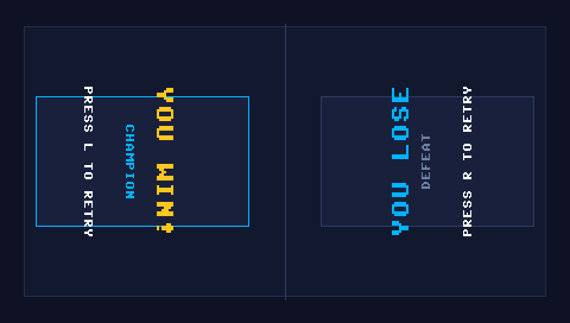

# 2 Player Games: The Challenge (PSP Edition)

A native C++11 and SDL2 Sony PlayStation Portable (PSP) homebrew port of the hit local multiplayer party game **"2 Player Games: The Challenge"** (originally by JindoBlu). 

Engineered from the ground up for strict 16:9 480×272 hardware canvas rendering and constrained within a lightweight heap memory budget (< 12MB, fully compatible with 32MB PSP-1000 models), this port delivers smooth 60 FPS competitive local 1v1 action on a single console, plus an algorithmic Single-Player VS AI engine.

<p align="center">
  
</p>

---

## Gameplay & Interface Gallery

| **1. Ping Pong (Table Tennis)** | **2. Air Hockey Table** |
|:---:|:---:|
|  |  |
| *High-speed dynamic paddle rally & 2P rotated score* | *2D mallet strikes, boundary rebounds & goal boxes* |

| **3. Spinner War (Sumo Ring)** | **4. Tank Battle (Ricochets)** |
|:---:|:---:|
|  |  |
| *Rotating top collisions, ring-out physics & Turbo Boost* | *Ricocheting cannon shells & obstacle barricades* |

| **5. Main Menu (Card Carousel)** | **6. Dual-Facing Match Over** |
|:---:|:---:|
|  |  |
| *Minigame carousel cards & split controls reminder* | *Dual rotated victory cards facing each player's controls* |

---

## Minigame Collection

1. **Ping Pong (Table Tennis):** Classic paddle rally battle with dynamic deflection angle physics and escalating volley velocity. First to 5 points wins.
2. **Air Hockey:** Full 2D arena hockey table with circular mallet and puck collision physics, boundary rebounds, goal pockets, and high-velocity smash strikes. First to 5 goals wins.
3. **Spinner War (Beyblade Sumo):** Floating circular ring arena battle. Steer high-torque spinning tops with blade collision impulses and Turbo Boost charges to knock the opponent into the void. First to 3 knockouts wins.
4. **Tank Battle:** Tactical battlefield with 6 brick barricades. Navigate top-down tanks and fire ricocheting cannon shells that bounce off perimeter and obstacle walls. First to 5 kills wins.

---

## Console Orientations & Dual Control Schemes

The game supports two distinct hardware operating paradigms configured seamlessly via the **SELECT** button:

### 1. 2-Player Mode (Local Split — Opponents Facing Console)

In 2-Player mode, the PSP is placed between both players on a flat surface or held from opposite ends. The top edge of the PSP is **North**. Player 1 sits on the West side (left) looking East into the screen; Player 2 sits on the East side (right) looking West into the screen.

```
                     [ TOP EDGE / NORTH ]
   [ L TRIGGER ]                               [ R TRIGGER ]
         │                                           │
         ▼                                           ▼
   PLAYER 1 (WEST)                             PLAYER 2 (EAST)
   Looking East into screen                    Looking West into screen
   ┌────────────────────┐                     ┌────────────────────┐
   │ UP    : D-PAD RIGHT│ (Towards Opponent)  │ UP    : SQUARE     │ (Towards Opponent)
   │ DOWN  : D-PAD LEFT │ (Towards Goal)      │ DOWN  : CIRCLE     │ (Towards Goal)
   │ LEFT  : D-PAD UP   │ (North)             │ LEFT  : CROSS      │ (South)
   │ RIGHT : D-PAD DOWN │ (South)             │ RIGHT : TRIANGLE   │ (North)
   │ ACTION: L TRIGGER  │                     │ ACTION: R TRIGGER  │
   └────────────────────┘                     └────────────────────┘
                     [ BOTTOM EDGE / SOUTH ]
```

#### Dual Facing In-Game UI
To deliver an authentic tabletop multiplayer experience, the HUD dynamically re-orients itself:
- **Player 1's HUD:** Scores, player labels, boost gauges, and end-game match results ("YOU WIN!" / "YOU LOSE") are rendered facing West so Player 1 reads them completely upright without tilting their head.
- **Player 2's HUD:** Scores, player labels, boost gauges, and end-game match results are rendered facing East so Player 2 reads them completely upright from their seat.

---

### 2. 1-Player Mode (Standard Handheld VS AI)

In 1-Player mode, the console is held in the standard landscape orientation:
- **Player 1 (Left Side):**
  - **D-Pad / Analog Nub:** Standard Directional movement (Up, Down, Left, Right).
  - **L Trigger / Cross:** Action / Turbo Boost / Cannon Fire.
- **Player 2 (AI Engine):** Fully autonomous algorithmic opponent.
- **UI:** Standard horizontal top bar HUD and centered victory modal.

### System Buttons
- **START:** Pause / Resume match overlay.
- **SELECT:** Instant toggle between `1 PLAYER (VS AI)` and `2 PLAYERS (SPLIT OPPS)`.

---

## Single Player VS AI Engine

In **1 Player (VS AI)** mode, Player 2 is autonomously driven by an algorithmic AI controller tailored to each minigame:
- **Ping Pong:** Real-time trajectory prediction tracking the ball's Y-coordinate with simulated human reaction latency and smooth interpolation.
- **Air Hockey:** Dynamic territorial AI defending its goal crease and executing offensive forward strikes when the puck crosses the centerline.
- **Spinner War:** Vector pursuit tracking Player 1's centroid and firing Turbo Boost charges during close-range collision vectors.
- **Tank Battle:** Predictive obstacle navigation, turret angle lead tracking, and projectile deflection aiming.

---

## Compilation & Packaging for Developers

### Prerequisites

Ensure you have the official `pspdev` toolchain installed with the `psp-sdl2` package:

```bash
export PSPDEV="/home/abdul/pspdev"
export PATH="$PSPDEV/bin:$PATH"
export PSPSDK="$PSPDEV/psp/sdk"
```

### Building the Game

```bash
# Clean and compile relocatable PRX EBOOT
make clean
make

# Generate distribution release archive
make package
```

The automated `make package` rule generates the standard directory structure:
```bash
mkdir -p PSP/GAME/2PlayerGames
cp EBOOT.PBP PSP/GAME/2PlayerGames/
zip -r 2PlayerGames_PSP.zip PSP/
```

---

## Installation for Players

1. Connect your PSP via USB or insert your Memory Stick into a PC card reader.
2. Download `2PlayerGames_PSP.zip` from the [GitHub Releases](../../releases) page.
3. Extract `2PlayerGames_PSP.zip` directly to the root of your Memory Stick (e.g., `E:\` or `F:\`).
4. Ensure the executable is located at:
   ```text
   ms0:/PSP/GAME/2PlayerGames/EBOOT.PBP
   ```
5. On your PSP, navigate to **Game $\rightarrow$ Memory Stick** on the XMB menu and launch **2 Player Games: The Challenge**.

---

## License & Credits

- **License:** Released under the [MIT License](LICENSE).
- **Original Game Concept:** Based on *"2 Player games: the Challenge"* by JindoBlu.
- **PSP Port & Engine Architecture:** Built using native C++11, PSPSDK, and SDL2 hardware abstraction.
