# 2 Player Games: The Challenge (PSP Edition)

A native C++11 and SDL2 Sony PlayStation Portable (PSP) homebrew port of the hit local multiplayer party game **"2 Player Games: The Challenge"** (originally by JindoBlu). 

Engineered from the ground up for strict 16:9 480×272 hardware canvas rendering and constrained within a lightweight heap memory budget (< 16MB, fully compatible with 32MB PSP-1000 models), this port delivers smooth 60 FPS competitive local 1v1 action on a single console, plus an algorithmic Single-Player VS AI engine across **24 complete minigames** arranged in an expandable 4-page grid carousel.

<p align="center">
  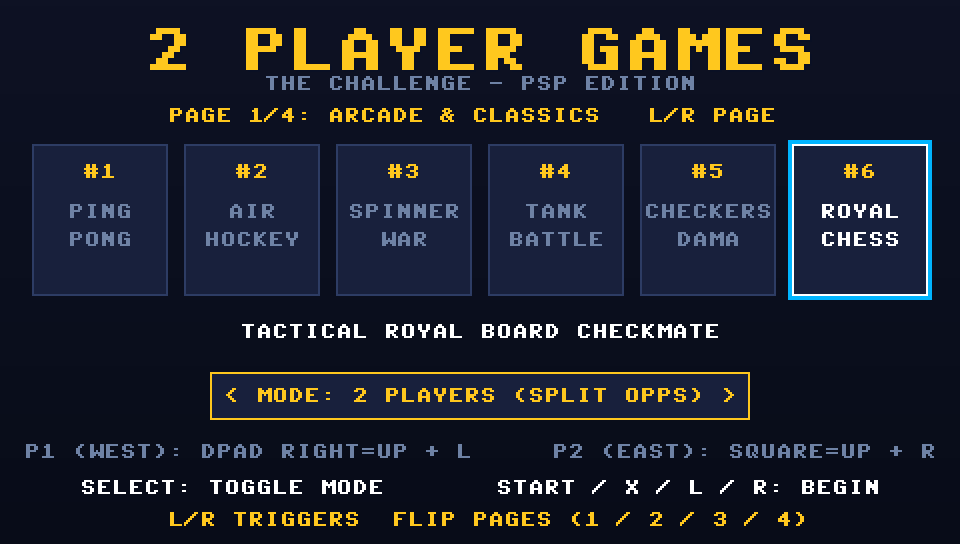
</p>

---

## Gameplay & Interface Gallery

| **1. Ping Pong (Table Tennis)** | **2. Air Hockey Table** |
|:---:|:---:|
| 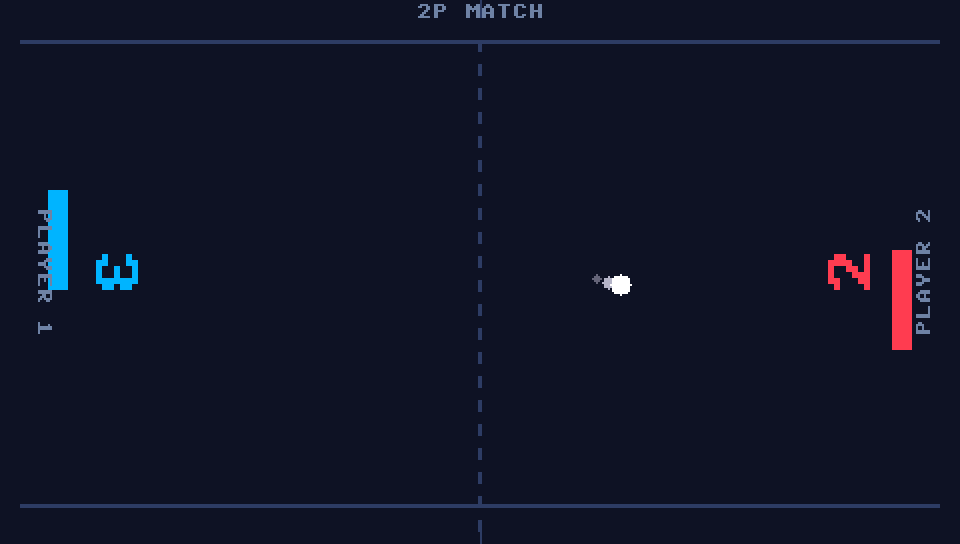 | 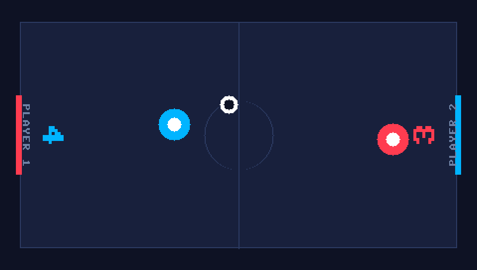 |
| *High-speed dynamic paddle rally & 2P rotated score* | *2D mallet strikes, boundary rebounds & goal boxes* |

| **3. Spinner War (Sumo Ring)** | **4. Tank Battle (Ricochets)** |
|:---:|:---:|
| 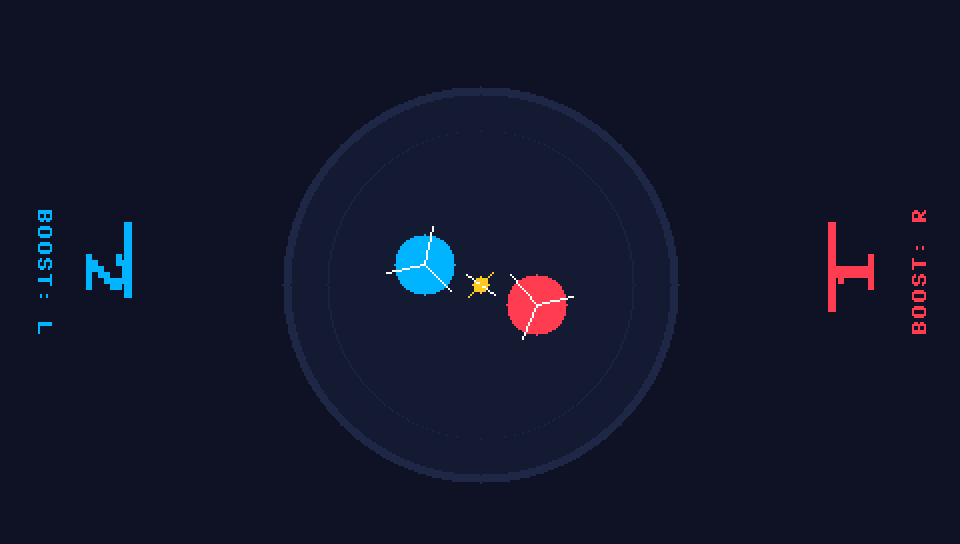 | 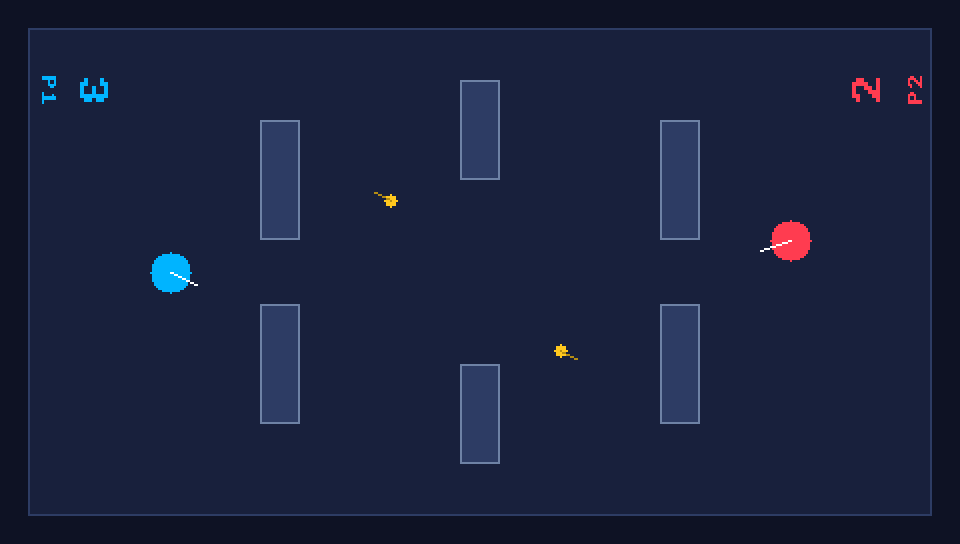 |
| *Rotating top collisions, ring-out physics & Turbo Boost* | *Ricocheting cannon shells & obstacle barricades* |

| **5. Checkers (Dama)** | **6. Chess (Royal Tactics)** |
|:---:|:---:|
| 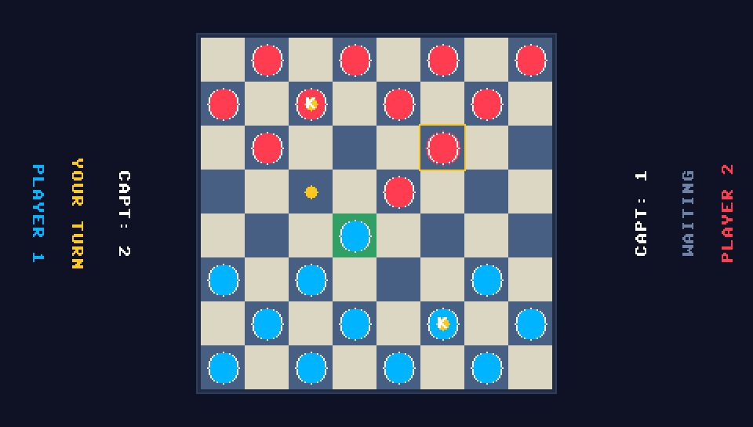 | 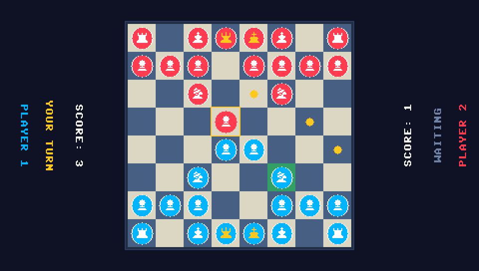 |
| *8×8 board, diagonal steps, crowned Kings & free piece selection* | *Vector piece silhouettes, ray validation, checks & smart AI* |

| **7. Tic-Tac-Toe (Tris)** | **8. Connect 4 (Four in a Row)** |
|:---:|:---:|
| 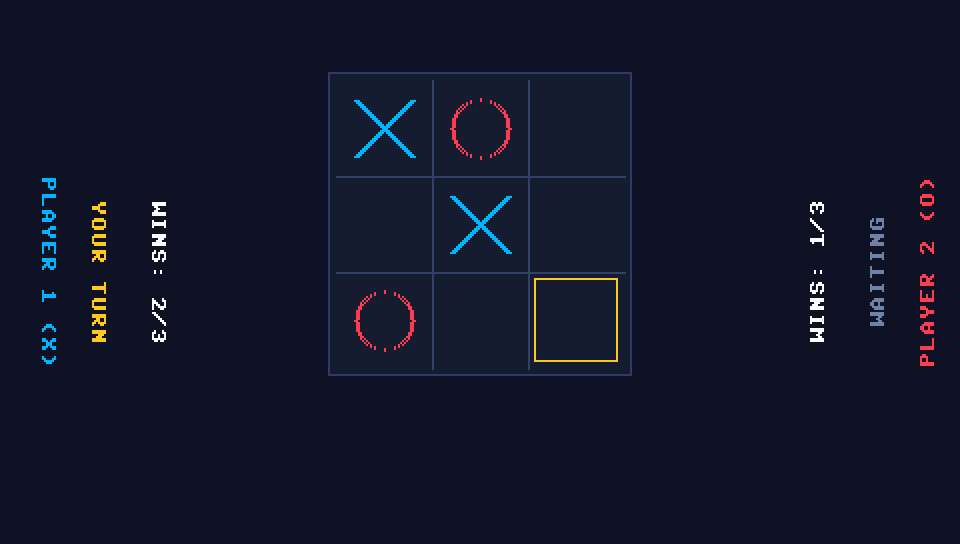 | 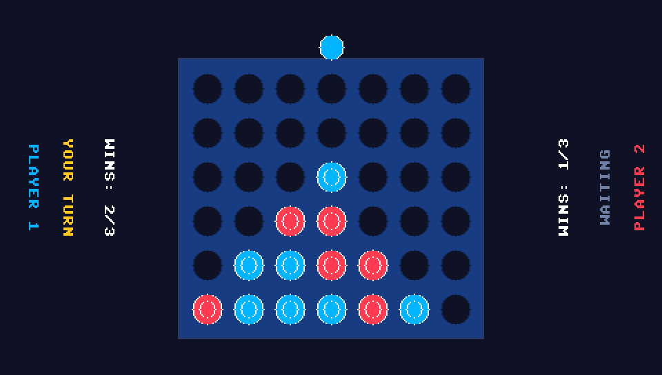 |
| *Classic 3×3 grid duel, win line strike & AI blocking* | *Vertical 7×6 gravity drop, slot cutouts & 4-chain tactics* |

| **9. Sumo (Dohyo Ring-Out)** | **10. Western Quick Draw** |
|:---:|:---:|
| 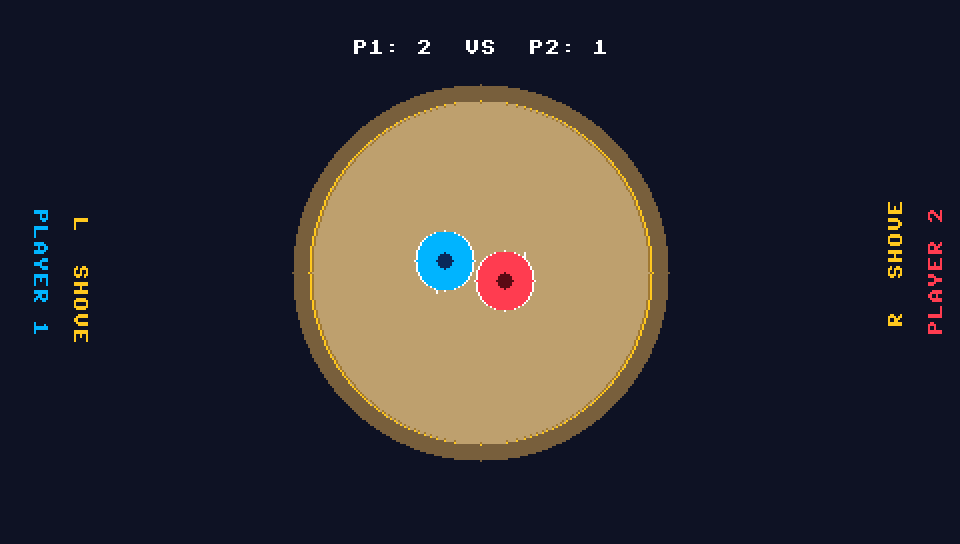 | 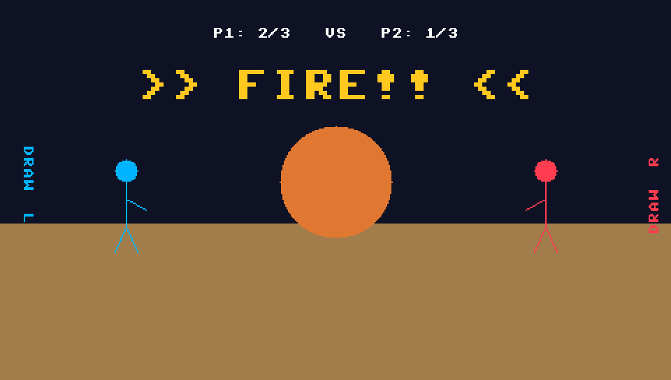 |
| *Circular sand ring, shoving momentum & ring-out physics* | *High-noon standoff, signal reaction & misfire penalties* |

| **11. Sling Puck (Finger Hockey)** | **12. Penalty Shootout** |
|:---:|:---:|
| 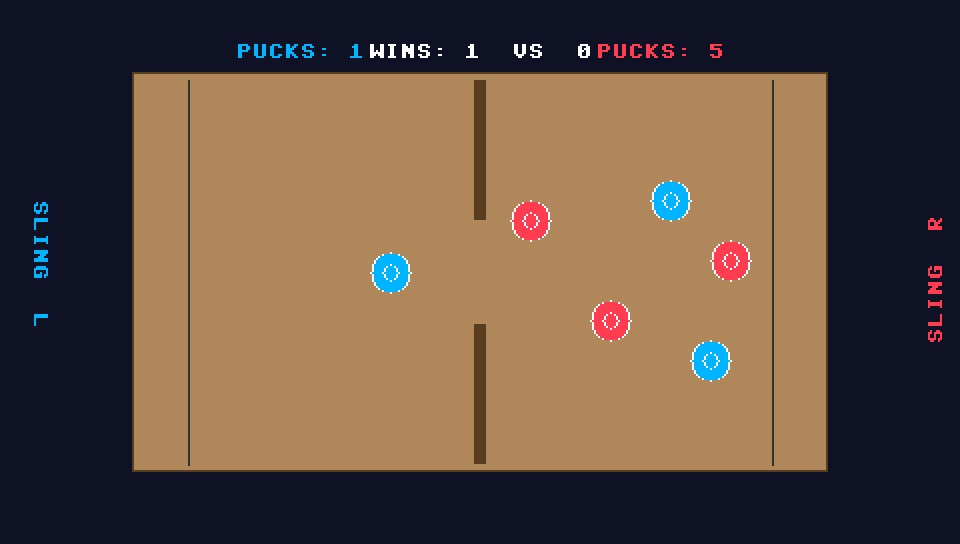 | 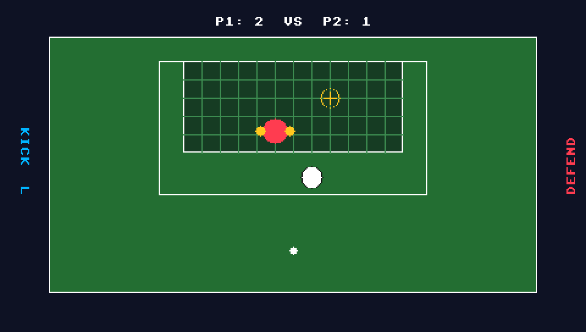 |
| *Hardwood board, elastic cords & center partition slot* | *Striker vs diving goalkeeper, oscillating aim & goal netting* |

| **13. Micro Racers (Circuit Sprint)** | **14. Basketball (Arc Shootout)** |
|:---:|:---:|
| 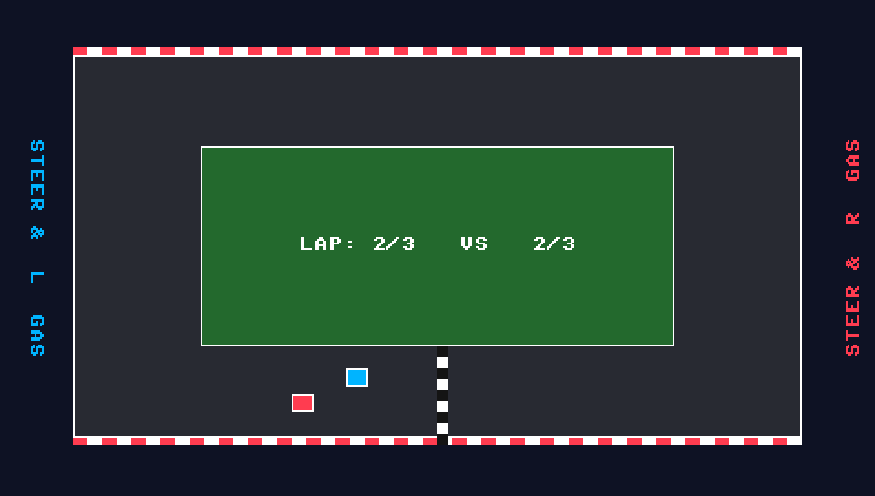 | 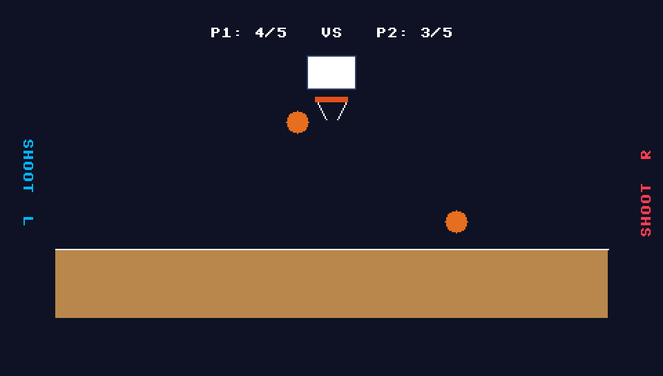 |
| *Top-down formula sprint, tire drifts & checkered laps* | *Parabolic trajectory physics, backboard/rim deflection* |

| **15. Bouncy Soccer (1v1 Football)** | **16. Bowling (10-Pin Lane)** |
|:---:|:---:|
| 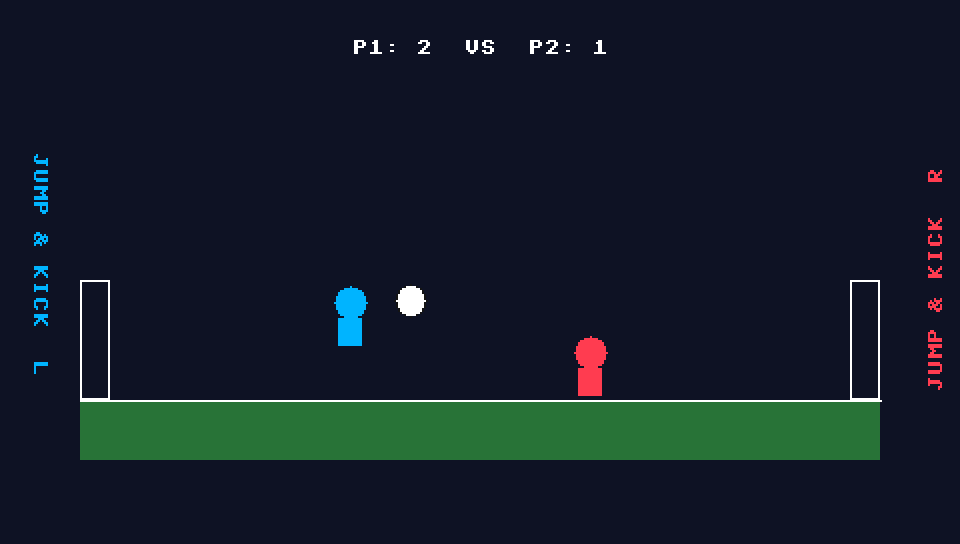 | 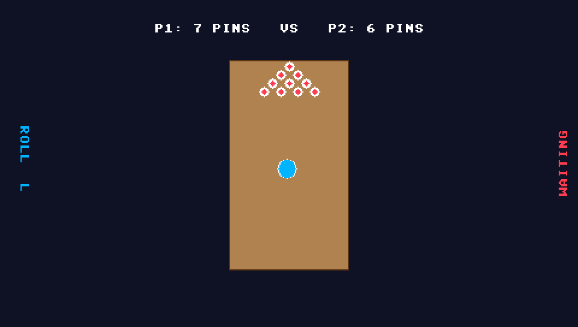 |
| *Ragdoll physics, header jumps, goal post ricochets* | *Perspective hardwood lane, pin scatter & hook delivery* |

| **17. Darts (301 Duel)** | **18. Main Menu (4-Page Carousel)** |
|:---:|:---:|
| 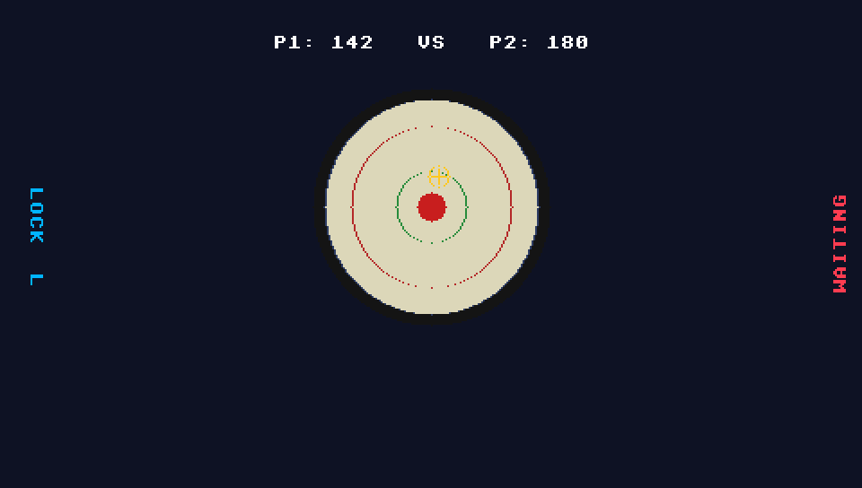 |  |
| *Dual-axis crosshair lock, bullseye & score countdown* | *4-page carousel with [L/R Triggers] instant flip* |

---

## Minigame Collection (24 Games Total)

### Page 1: Arcade & Action Classics
1. **Ping Pong (Table Tennis):** Classic paddle rally battle with dynamic deflection angle physics and escalating volley velocity. First to 5 points wins.
2. **Air Hockey:** Full 2D arena hockey table with circular mallet and puck collision physics, boundary rebounds, goal pockets, and high-velocity smash strikes. First to 5 goals wins.
3. **Spinner War (Beyblade Sumo):** Floating circular ring arena battle. Steer high-torque spinning tops with blade collision impulses and Turbo Boost charges to knock the opponent into the void. First to 3 knockouts wins.
4. **Tank Battle:** Tactical battlefield with 6 brick barricades. Navigate top-down tanks and fire ricocheting cannon shells that bounce off perimeter and obstacle walls. First to 5 kills wins.
5. **Checkers (Dama):** Authentic 8×8 tournament checkers. Forward diagonal strides, jump captures over opponent pieces, crowning Kings upon reaching the baseline, and free selection across all valid moves.
6. **Chess:** Complete royal strategy chess featuring Pawns, Knights, Bishops, Rooks, Queens, and Kings rendered with detailed vector silhouettes. Strict check detection, piece-square evaluation AI, and promotion mechanics.

### Page 2: Tabletop & Strategy (Wave 2)
7. **Tic-Tac-Toe (Tris):** Fast-paced 3×3 line completion duel. Dynamic win-strike rendering, center/corner AI heuristics, and best-of-3 tournament scoring.
8. **Connect 4:** Vertical 7×6 gravity-drop chip duel with tactile slotted cutouts. Column-by-column AI evaluating immediate and future 4-in-a-row opportunities.
9. **Dots & Boxes:** 4×4 dot grid territory capture. Players alternate drawing horizontal and vertical line segments; completing a box captures it and grants an immediate bonus turn.
10. **Reversi (Othello):** 8×8 tournament disc-flipping board with center starters, valid move dot indicators, and a positional matrix AI favoring corners (+100) and edge anchors.
11. **Battleship (Naval Salvo):** Split-screen 6×6 naval radar combat. Hunt and sink the enemy fleet (Carrier, Cruiser, Patrol) with explosive hit effects and hunting AI.
12. **Tug of War:** High-cadence button mashing rope battle over a center mud pit! Features dynamic rope physics tension, animated stick tuggers leaning back, and fatigue-scaled CPU AI.

### Page 3: Brawlers & Reflexes (Wave 3)
13. **Sumo:** Circular Dohyo arena with straw borders. Wrestlers push and shove each other; first to knock the opponent out of the ring takes the point.
14. **Neon Snake (Light Cycles):** 40×22 neon grid. Steer high-speed light trails; hitting outer perimeter walls, your own body, or your opponent's trail causes immediate elimination.
15. **Red Hands (Slap & Dodge):** Authentic hand slap duel. The attacker aims to slap before the defender can dodge; false dodges trigger penalty strikes. First to 5 hits wins.
16. **Knife Hit:** Dual rotating timber targets. Race to stick all 6 knives into the revolving wood wheel without clipping previously embedded blades.
17. **Western Quick Draw:** Standoff at high noon. Wait for the sudden gong signal and draw your revolver before your opponent, avoiding fatal early draw fouls.
18. **Sling Puck:** Fast-paced finger hockey. Fling pucks using elastic bands across a wooden arena through a narrow center partition gate. First to clear all pucks from their half wins.

### Page 4: Sports & Targets (Wave 4)
19. **Penalty Shootout:** Striker vs Goalkeeper showdown. Time your shot along an oscillating aim arc while the keeper anticipates the dive angle.
20. **Micro Racers:** Top-down circuit sprint racing. Counter-steer through asphalt corners, manage drift physics, and cross the checkered finish line first across 3 laps.
21. **Basketball Shootout:** Timed release arc shot. Launch basketballs along realistic parabolic gravity curves toward backboards and hoop rims. First to 5 baskets wins.
22. **Bouncy Soccer:** Head-to-head 1v1 ragdoll football. Run, jump, and execute diving headers to knock the ball into the opponent's goal net.
23. **Bowling:** Perspective hardwood 10-pin lane. Steer your delivery curve and hit the pocket to scatter pins and achieve a clean strike.
24. **Darts (301 Target Duel):** Precision dartboard showdown. Lock your horizontal and vertical crosshairs to strike triples, doubles, and the bullseye to count down to zero.

---

## Console Orientations & Dual Control Schemes

The game supports two distinct hardware operating paradigms configured seamlessly via the **SELECT** button:

### 1. 2-Player Mode (Local Split — Opponents Facing Console)

In 2-Player mode, the PSP is placed between both players on a flat surface or held from opposite ends. The top edge of the PSP is **North**. Player 1 sits on the West side (left) looking East into the screen; Player 2 sits on the East side (right) looking West into the screen.

```
                     [ TOP EDGE / NORTH ]
   [ L TRIGGER ]                               [ R TRIGGER ]
         │                                           │
         ▼                                           ▼
   PLAYER 1 (WEST)                             PLAYER 2 (EAST)
   Looking East into screen                    Looking West into screen
   ┌────────────────────┐                     ┌────────────────────┐
   │ UP    : D-PAD RIGHT│ (Towards Opponent)  │ UP    : SQUARE     │ (Towards Opponent)
   │ DOWN  : D-PAD LEFT │ (Towards Goal)      │ DOWN  : CIRCLE     │ (Towards Goal)
   │ LEFT  : D-PAD UP   │ (North)             │ LEFT  : CROSS      │ (South)
   │ RIGHT : D-PAD DOWN │ (South)             │ RIGHT : TRIANGLE   │ (North)
   │ ACTION: L TRIGGER  │                     │ ACTION: R TRIGGER  │
   └────────────────────┘                     └────────────────────┘
                     [ BOTTOM EDGE / SOUTH ]
```

#### Dual Facing In-Game UI
To deliver an authentic tabletop multiplayer experience, the HUD dynamically re-orients itself:
- **Player 1's HUD:** Scores, player labels, boost gauges, turn alerts, and end-game match results ("YOU WIN!" / "YOU LOSE") are rendered facing West so Player 1 reads them completely upright without tilting their head.
- **Player 2's HUD:** Scores, player labels, boost gauges, turn alerts, and end-game match results are rendered facing East so Player 2 reads them completely upright from their seat.

---

### 2. 1-Player Mode (Standard Handheld VS AI)

In 1-Player mode, the console is held in the standard landscape orientation:
- **Player 1 (Left Side):**
  - **D-Pad / Analog Nub:** Standard Directional movement (Up, Down, Left, Right).
  - **L Trigger / Cross:** Action / Turbo Boost / Select / Confirm.
- **Player 2 (AI Engine):** Autonomous algorithmic opponent.
- **UI:** Standard horizontal top bar HUD and centered victory modal.

### Board Games Cursor Controls (Chess & Checkers)
- **D-Pad / Shapes:** Navigate board cursor across rows and columns.
- **Action (L / R Trigger / Cross / Circle):** Select piece / Confirm destination square / Deselect.
- **Highlighting:** Emerald green highlights active piece; vibrant gold dots indicate valid target squares; hollow red rings indicate capture opportunities.

### System Buttons
- **START:** Pause / Resume match overlay.
- **SELECT:** Instant toggle between `1 PLAYER (VS AI)` and `2 PLAYERS (SPLIT OPPS)`.

---

## Single Player VS AI Engine

In **1 Player (VS AI)** mode, Player 2 is autonomously driven by an algorithmic AI controller tailored to each minigame:
- **Ping Pong:** Real-time trajectory prediction tracking the ball's Y-coordinate with simulated human reaction latency and smooth interpolation.
- **Air Hockey:** Dynamic territorial AI defending its goal crease and executing offensive forward strikes when the puck crosses the centerline.
- **Spinner War:** Vector pursuit tracking Player 1's centroid and firing Turbo Boost charges during close-range collision vectors.
- **Tank Battle:** Predictive obstacle navigation, turret angle lead tracking, and projectile deflection aiming.
- **Checkers:** Minimax heuristic prioritizing jump captures, King crownings, and center-board territorial dominance.
- **Chess:** Alpha-beta search evaluating piece values (Q:900, R:500, B:330, N:320, P:100), piece-square tables, King safety, and tactical pawn development.

---

## Compilation & Packaging for Developers

### Prerequisites

Ensure you have the official `pspdev` toolchain installed with the `psp-sdl2` package:

```bash
export PSPDEV="/home/abdul/pspdev"
export PATH="$PSPDEV/bin:$PATH"
export PSPSDK="$PSPDEV/psp/sdk"
```

### Building the Game

```bash
# Clean and compile relocatable PRX EBOOT
make clean
make

# Generate distribution release archive
make package
```

The automated `make package` rule generates the standard directory structure:
```bash
mkdir -p PSP/GAME/2PlayerGames
cp EBOOT.PBP PSP/GAME/2PlayerGames/
zip -r 2PlayerGames_PSP.zip PSP/
```

---

## Installation for Players

1. Connect your PSP via USB or insert your Memory Stick into a PC card reader.
2. Download `2PlayerGames_PSP.zip` or the standalone `EBOOT.PBP`.
3. Deploy to your Memory Stick:
   ```text
   ms0:/PSP/GAME/2PlayerGames/EBOOT.PBP
   ```
4. On your PSP, navigate to **Game $\rightarrow$ Memory Stick** on the XMB menu and launch **2 Player Games: The Challenge**.

---

## License & Credits

- **License:** Released under the [MIT License](LICENSE).
- **Original Game Concept:** Based on *"2 Player games: the Challenge"* by JindoBlu.
- **PSP Port & Engine Architecture:** Built using native C++11, PSPSDK, and SDL2 hardware abstraction.
